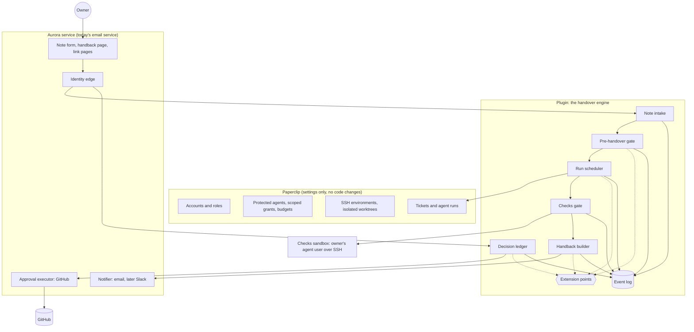
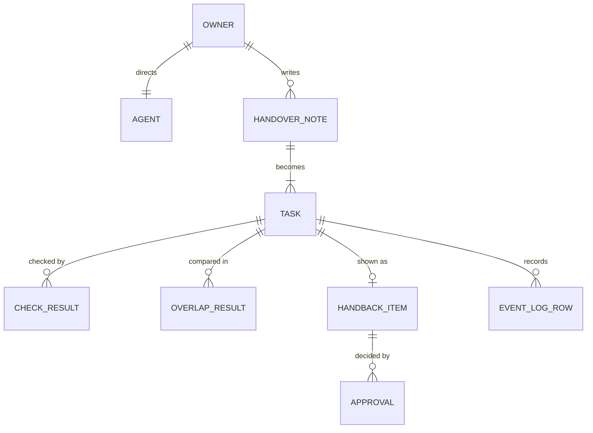
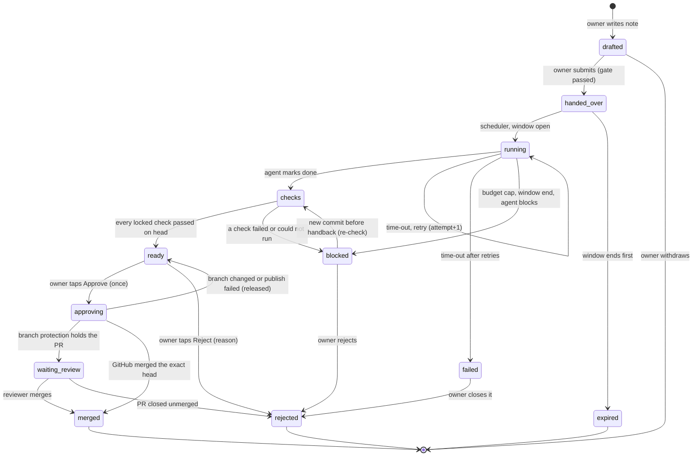

# Target architecture: the handover core

**Words.** Technical terms are defined once, in the "Words used below" list of CURRENT-STATE.md.

**What this is.** The shape the code should grow into for the team handover. It keeps what works (see CURRENT-STATE.md) and fixes the seams that don't. Hardy is not in the core: it plugs into named extension points (section 5). Code references point at commit `0137939` on `claude/eloquent-hopper-9m2e04`.

## 1. Rules the design follows

1. **The owner writes the work.** A handover starts from the owner's handover note, not from the agent's proposal. The agent may help draft; the owner submits.
2. **One source of truth for task state**: the plugin's tables. Everything else (emails, pages, GitHub) is a view or an executor.
3. **Every state change is a compare-and-swap** (change it only if it still looks as last seen) on the task's state and version, so a crash, a double click or two ticks can never apply a step twice.
4. **No step that spans several writes may leave junk.** Paperclip gives plugins no database transactions (`plugin-sdk/dist/types.d.ts:405-414`), so multi-step work goes through a small operations journal (section 4.4).
5. **Authority is checked at the seam.** The plugin trusts a route call only from the Aurora service's own Paperclip user, and an owner's decision only with that owner's proof (a signed link, or a Paperclip session the service verified). This closes S1 in CURRENT-STATE.md.
6. **Nothing merges, sends, deploys, deletes or spends without the owner's tap**, and no extension can add a way round that.

## 2. Components

| Component | Single responsibility | Lives in | Today |
| --- | --- | --- | --- |
| Note intake | Turn an owner's handover note into tasks, exactly as written | Plugin | Missing: the agent proposes (`plugin/src/handoverrunner.ts:379`) |
| Pre-handover gate | Compare claims with owner areas and open claims; at most 3 questions per owner; run pre-handover hooks | Plugin | `plugin/src/prehandover.ts:44` |
| Run scheduler | Start, time, retry, budget-stop each task in its window | Plugin | `plugin/src/handover.ts:88`, `plugin/src/handoverrunner.ts:196` |
| Checks gate | Run the locked checks on the exact head: diff size, secret scan, claims-vs-diff, tests, lint, done-when commands | Plugin + sandbox | Partly: `plugin/src/checks.ts:107`, no claims or done-when |
| Handback builder | Classify each task, run pre-handback checkers (merge replay is the first), build the list | Plugin | `plugin/src/briefing.ts:127` |
| Decision ledger | Record approve/reject once, version-checked, owner-bound; hand GitHub work to the executor | Plugin | `plugin/src/links.ts:109`, `plugin/src/briefstore.ts:158-199` |
| Event log | Append every transition; keep the one-row-per-task summary as a view | Plugin | Summary only (`plugin/migrations/001_task_events.sql`) |
| Identity edge | Prove who is acting: Paperclip session or signed link; call the plugin as the service user | Service | Half: `email-service/src/server.ts:83-101` |
| Approval executor | Push the exact commit, open the PR, merge with GitHub's sha check, report back | Service | `email-service/src/github.ts:114-140` |
| Notifier | Deliver handback lists and notices; at-least-once, deduplicated by id | Service | `email-service/src/mailer.ts:34-46` |

## 3. Data model

| Entity | Fields | Notes |
| --- | --- | --- |
| **Owner** | email, paperclipUserId, githubLogin, timezone, schedule (start hour, length), limits (tasks per handover, budget cents), modelAccess, keys[] {name, secretRef, access} | From plugin settings today (`plugin/src/config.ts:35-60`). Add `paperclipUserId` so a session maps to exactly one owner. |
| **Agent** | agentId, ownerEmail, adapterType, environmentId, systemUser, checksKeyRef, status | One per owner. Isolation audit stays (`plugin/src/isolation.ts:69`). |
| **HandoverNote** (new) | id, owner, createdAt, submittedAt, title, what (text), doneWhen[] {kind: command or manual, text, command?}, limits {maxDiffLines, maxMinutes, budgetCents}, claims[], schedule (now or next window), status (draft, submitted, withdrawn) | Written by the owner on the service's note page. `what` and `doneWhen.text` are shown to the agent as its brief. Command criteria are **locked**: copied into the task when submitted and never read back from the branch. |
| **Task** | id (Paperclip ticket id), noteId, owner, agentId, handoverKey, state, version, claims[], limits, branch, worktree, baseRef, attempt, stepStartedAt, stopReason | `state` and `version` drive the state machine (section 4). |
| **CheckResult** | taskId, headSha, kind (diff-size, secret-scan, claims, tests, lint, done-when, or an extension's kind), status (passed, failed, advisory, could-not-run), summary, evidenceRef, source (core or extension name) | Today one result per task (`task_events.checks_result`). Becomes one row per check per head. |
| **OverlapResult** | id, taskId, phase (before or after), otherTaskId or areaRule, files[], keeper, headA, headB, announcedAt | Merges today's `overlaps` and `conflicts` tables. |
| **HandbackItem** | id, handbackId, taskId, category (ready, blocked, failed, waiting), tier (needs you, review suggested, passed under your rules), summary, evidence[], expectedHead | Today `briefings.items` JSON (`plugin/src/briefstore.ts:10-25`). |
| **Approval** | id, itemId, taskId, owner, kind (approve or reject), channel (link or app), expectedHead, state (new, processing, done, refused), result, reason, usedAt, expiresAt | Today `link_actions`. The id is the idempotency key. |
| **EventLogRow** | id, taskId, at, actor (owner, agent, system, extension name), fromState, toState, reason, evidenceRef | Append-only. The CLAUDE.md row-per-task log becomes a view over it. |

## 4. Task lifecycle

### 4.1 Who moves each step

| Step | Mover | Guard |
| --- | --- | --- |
| drafted → handed_over | Owner (note page), via the identity edge | Pre-handover gate and pre-handover hooks; at most 3 questions; any blocking finding keeps it drafted |
| handed_over → running | Run scheduler tick | Window open, agent locked down, budget left, no other running task for this owner (or parallel limit, later) |
| running → checks | Agent marks the ticket done; the tick notices | Worktree exists and is a git worktree |
| checks → ready/blocked | Checks gate, started by the **tick**, not by the agent | Results stored per head; claims-vs-diff is a check |
| ready → approving/rejected | Owner, with a signed link or an in-app tap | Approval CAS, task CAS, owner binding (`plugin/src/links.ts:65-89` today) |
| approving → merged/waiting/ready | Approval executor reports; the tick recovers interrupted ones | GitHub `sha` check; stuck after 15 minutes is recovered (`plugin/src/links.ts:345-365` today) |

### 4.2 Time-outs

- **Step time-out** (default 60 min): retry once, then `failed` (today `plugin/src/handover.ts:143-147`). Before retrying, the scheduler asks Paperclip to cancel the old run where the SDK allows it; **ASSUMPTION** that a cancel call exists for plugins is unverified, so the design does not depend on it: the retry waits until Paperclip shows the ticket's run as finished.
- **Window end**: a running task goes to `blocked` with reason "window ended", but `blocked` is not final: if a new commit appears and its checks pass before the handback is built, it becomes `ready` (fixes B4).
- **Undecided too long**: after N handbacks (setting, default 3) an undecided task's claims are released and its item says so (fixes B3). The branch is kept.

### 4.3 Crash and restart

All state is in the plugin's tables. The tick (every 5 minutes, plus on demand) re-reads everything and re-decides; each step is a CAS on `(taskId, state, version)`, so a step that already happened does nothing the second time. This is how the current engine already works (`plugin/src/handoverstore.ts:108-124`); the design extends it from runs to tasks.

### 4.4 Operations journal (no transactions)

A multi-step action first writes one `operations` row (id = idempotency key, kind, payload, state `pending`), then does each step idempotently (each step checks whether it already happened), then marks the row `done`. The tick finishes any `pending` row older than 2 minutes, or undoes it if it cannot finish. Used for: note submission (tickets + claims + run), handback creation (items + approval rows), approval publishing. Fixes B1 and B2.

### 4.5 Double click

Unchanged and proven: the approval row moves `new → processing` only once (`plugin/src/briefstore.ts:158-164`); the task's decision is taken only once (`plugin/src/briefstore.ts:187-199`); GitHub merges only the approved sha. Two tabs, two devices or a mail scanner all end in one merge.

## 5. Extension points

Four named interfaces, plus two smaller ones listed below the table. Hardy (HARDY.md) and any later framework plug in here; the core never needs rewriting. Each extension is a module registered in a list in the plugin, called with **structured data only**, and returns findings. Agent-written text reaches an extension only inside an `UntrustedText` field (shown escaped, never followed as instructions).

| Extension point | Called | Receives | May return | May never |
| --- | --- | --- | --- | --- |
| `PreHandoverHook` | When a note is submitted, before tasks exist | The note's claims, limits and done-when kinds; open claims; owner areas; contracts (if any) | Findings: info, question (counts toward the 3), or block; a suggested keeper | Edit the note, create tickets |
| `RunWatcher` | Every tick for running tasks | Changed file names so far, spend, elapsed time, attempt, check results | Findings; ask the core to pause this task (automatic tier) | Stop other owners' tasks, change code |
| `PreHandbackChecker` | When the handback is built, per ready candidate | Head sha, diff stats, changed files, locked check results, other owners' ready heads | CheckResults (pass, fail, advisory, could-not-run) with evidence | Mark a task ready that the core blocked |
| `DecisionRouter` | For each handback item | The item, its findings, owner areas | Which owners must decide; the tier | Approve, merge, or route to no one |

Common rules, enforced by the core, not by the extension:

- Each has a time limit (default 30 s) and a declared failure mode: `fail-closed` (a crash blocks the task, shown as "could not run") or `advisory` (a crash adds a note). Built-in safety checks are fail-closed.
- No extension receives the Paperclip context, secrets, or a way to call routes. Output types have no "approve" or "merge" member.
- The core's own merge replay (`plugin/src/replay.ts:58`) and claims-vs-diff check are re-written as the first two `PreHandbackChecker`s. If the core can host its own checks through the seam, Hardy fits without changes.
- A fifth, read-only listener, `DecisionListener`, receives each final decision from the event log, for learning (Hardy's precedents).
- A sixth, `ClaimSource`, supplies claims from outside Aurora's own agents: another vendor's branches and pull requests, or an MCP claim tool any agent can call (Hardy v2's Intake layer, research p.12, p.14). Its claims enter the pre-handover gate as **open claims of that owner**, with the same validation as `propose_handover`; a `ClaimSource` can never create tasks or start runs.

## 6. What lives where, and why

| Concern | Where | Why |
| --- | --- | --- |
| Who may assign and configure which agent; agents never create agents or skills; hard budgets; SSH environments | **Paperclip settings** | Plugins may not change approval, auth, checkout or budget logic (aurora-v1-spec.md:295, citing Paperclip's plugin spec). Settings already cover it; the plugin audits them (`plugin/src/routes.ts:42`). |
| Plan-level confirmation inside Paperclip | **Paperclip** (`human_only`) until an upstream "this user only" policy exists | Paperclip offers only `anyone`, `not_creator`, `human_only` (`plugin/node_modules/@paperclipai/shared/dist/constants.js:221-225`). With owner-written notes the plan confirmation becomes unnecessary: the owner's submit is the approval. |
| Handover engine, tasks, claims, checks, handback, decision ledger, event log, extension host | **Plugin** | It needs tickets, agents, worktrees and Paperclip's database; it already holds this state with tested CAS logic. |
| Identity edge, pages, GitHub, mail, Slack later, the GitHub token | **Aurora service** | Plugin routes are board-only and JSON-only in 2026.1012.0 (CLAUDE.md decisions, M4 and piece F); public pages and secrets outside Paperclip need their own process. |
| Locked checks | **Sandbox** (owner's agent user today; Hardy's own user later) | Agent-written test code must never run as Paperclip's user (piece A). |

**The seam between plugin and service.** Every plugin route checks `input.actor.userId` against a configured `serviceUserId` (the SDK supplies it: `plugin-sdk/dist/define-plugin.d.ts:104-110`) and refuses anyone else. Calls that act for an owner carry proof: a signed link token (verified again in the plugin, as today) or a session assertion the service obtained from Paperclip's `/api/auth/get-session` and that the plugin maps to `Owner.paperclipUserId`. Wire types are defined once in a small shared package used by both sides, instead of being copied (CURRENT-STATE.md, fragile parts).

**What this design deliberately does not do.** It does not move task state into the service (two stores without a shared transaction would drift), does not fork Paperclip, and does not depend on any upstream change. Three upstream asks would simplify it later: a "specific user" confirmation policy, public plugin routes, and plugin database transactions.
