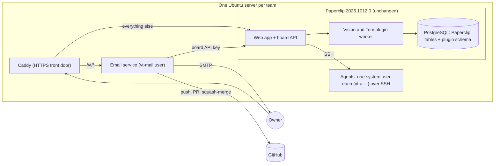
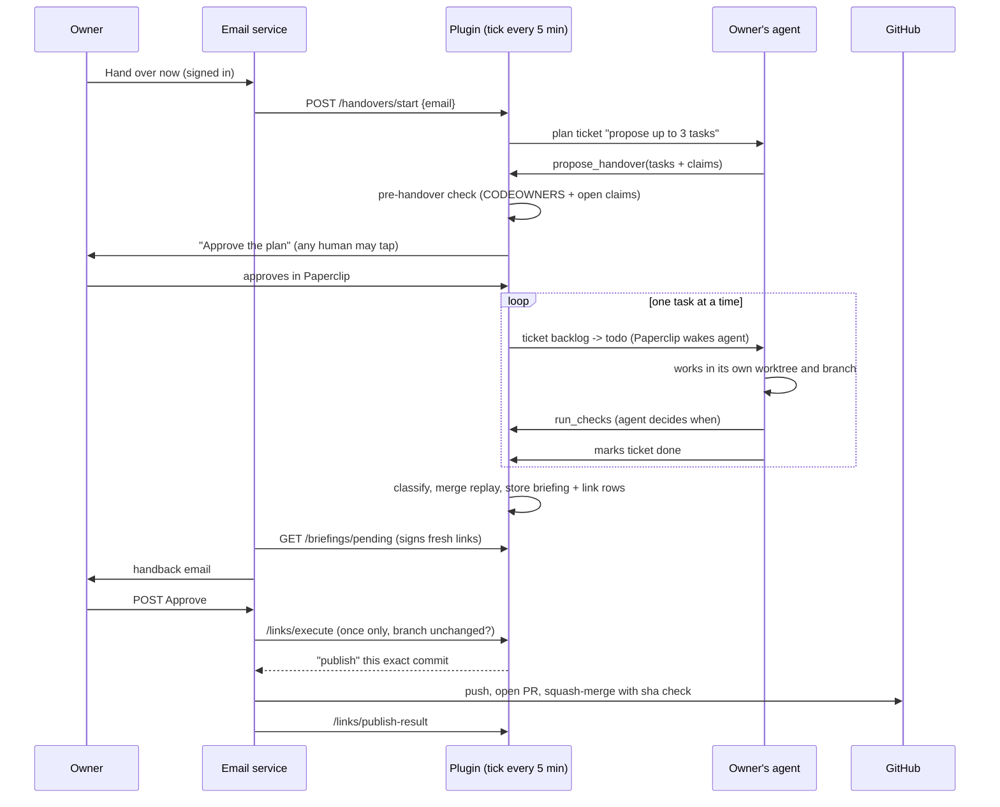

# Current state of the code (31 October 2026)

**What this is.** A plain-English map of the code as it is today, then a blunt verdict on its quality. Design only: nothing was changed.

**Which code.** Every `file:line` points at commit `0137939` on `claude/eloquent-hopper-9m2e04`, the newest code. `main` is behind it (main still has the old night-only build without pieces A to G). Paperclip facts were checked in the installed SDK, `@paperclipai/plugin-sdk` 2026.1012.0, in `plugin/node_modules`. Anything not proven there is marked **ASSUMPTION**.

**Also see** `DEVIATIONS.md` on `claude/intent-audit`, an independent audit against `INTENT.md` that found most of the same issues; B8 and B9 below come from it.

**Checked today.** Plugin: 388 unit tests pass, typecheck clean. Email service: 51 pass. Collision audit: 20 pass (PROGRESS.md still says 9). No live run was repeated.

## Words used below

- **Paperclip**: the open-source app Aurora runs inside. It holds companies, people, agents, tickets ("issues"), budgets and the web pages.
- **Plugin**: code Paperclip loads and runs in a separate process (the **worker**). It can only do what its **manifest** (a list of permissions, called **capabilities**) allows.
- **SDK**: Paperclip's toolkit for writing plugins; its type files say exactly which calls exist.
- **Route**: a web address that runs code. **Board route**: one Paperclip only lets signed-in humans or human API keys call, never agents.
- **Branch / worktree**: a branch is a named line of commits in git. A worktree is a separate folder checked out on one branch, so two agents never edit the same folder.
- **Merge replay**: test-merging two branches in memory to see if they conflict, without changing anything.
- **Idempotent**: doing it twice has the same effect as once.
- **Compare-and-swap (CAS)**: "change this row only if it still looks the way I last saw it". It stops two workers stepping on each other.
- **Commit sha** (or "head"): the unique id of one version of a branch. "Version check" means comparing shas.
- **Pull request (PR)**: GitHub's request to merge a branch, where reviews happen. **Squash-merge**: merging it as one single commit.
- **CODEOWNERS**: a file in the repository that says which person owns which folders.
- **SSH**: a secure way to log in as another user account and run commands. **systemd**: Linux's service manager, which starts programs at boot and restarts them.
- **Claims**: the files and folders a task says it may change.

## The pieces

| Piece | Folder | Size | Job |
| --- | --- | --- | --- |
| Plugin | `plugin/` | 5,291 lines of code, 3,411 of tests | Every decision: handovers, claims, checks, handback emails, link checks, merges, numbers |
| Email service | `email-service/` | 1,380 code, 1,082 tests | Sends mail, serves the Approve/Reject/invite/Hand-over-now pages, holds the GitHub token, does joins with the admin's API key |
| Server kit | `deploy/` | 1,452 | Install, users, systemd units, Caddy, backup/restore, `vt-*` admin commands |
| Live tests | `scripts/` | 2,152 | Real Paperclip test bed and a full deploy rehearsal |
| Collision audit | `tools/collision-audit/` | 1,337 | Read-only replay of a team's git history (Python) |

## Plugin modules

| Module | What it does | Key lines |
| --- | --- | --- |
| `worker.ts` | Entry point: registers 3 agent tools, 5 data views, the tick, and 17 board routes | `plugin/src/worker.ts:63-395` |
| `manifest.ts` | Capabilities, the 5-minute job, tools, routes | `plugin/src/manifest.ts:16-77` |
| `config.ts` | Settings form (JSON schema) plus a separate hand-written validator; old "night" names migrated | `plugin/src/config.ts:170-322`, `:395-553` |
| `handover.ts` | Pure decision engine: given a run and the facts, returns the one next step | `plugin/src/handover.ts:88-154` |
| `handoverrunner.ts` | Reads Paperclip, calls the engine, carries out the step; Hand over now; the proposal tool | `plugin/src/handoverrunner.ts:101-137`, `:379-490` |
| `handoverstore.ts` | `handover_runs` table, CAS updates, spend from Paperclip's `cost_events` | `plugin/src/handoverstore.ts:108-133` |
| `proposal.ts`, `claims.ts`, `prehandover.ts`, `repoareas.ts`, `claimstore.ts` | Piece D: parse the agent's proposal, match claims against CODEOWNERS and open claims, move overlapping tasks to the keeper | `plugin/src/prehandover.ts:44-83` |
| `checks.ts`, `checksandbox.ts`, `secretscan.ts`, `git.ts` | Checks gate: diff size, secret scan, tests, lint (tests/lint over SSH as the owner's agent user) | `plugin/src/checks.ts:107-147` |
| `briefing.ts`, `briefstore.ts` | Builds the handback email, classifies Ready/Blocked/Failed, carries undecided tasks over | `plugin/src/briefing.ts:53-65`, `:127-228` |
| `replay.ts`, `conflictstore.ts` | Piece E: `git merge-tree` of ready branches, conflicts announced once | `plugin/src/replay.ts:14-73` |
| `tokens.ts`, `links.ts`, `merge.ts` | Signed links, one-click-once, version check, local merge or "publish" request, crash recovery | `plugin/src/links.ts:109-175`, `plugin/src/merge.ts:54-88` |
| `invites.ts` | Signed one-time invite links, retries after a failed join | `plugin/src/invites.ts:88-287` |
| `isolation.ts`, `routes.ts`, `modelaccess.ts` | Refuse to work for an agent that can create agents/skills, is CEO, is not in its owner's SSH environment, or uses someone else's Claude access | `plugin/src/isolation.ts:69-73` |
| `numbers.ts`, `numberstore.ts` | Piece F: yield, minutes to approve, decisions, overlaps, conflicts, CSV | `plugin/src/numbers.ts:76-183` |
| `tiers.ts` | A list of every action as automatic / needs-tap / never | `plugin/src/tiers.ts:10-34` |
| `ticker.ts`, `schedule.ts`, `workspace.ts`, `handoff.ts`, `secrets.ts` | Tick loop, per-timezone clock, worktree settings, hand-off tool, key picker | |

Plugin tables (`plugin/migrations/001`-`009`): `task_events` (the event log, one row per task), `handover_runs`, `briefings`, `link_actions`, `invites`, `pull_requests`, `overlaps`, `conflicts`.

## How one handover flows today

## Where Paperclip ends and Aurora begins

| Paperclip does | Aurora adds |
| --- | --- |
| Accounts, sign-in, roles, companies | One person = one agent binding, in plugin settings |
| Agents, adapters, SSH "environments", run tokens, budgets with hard stops | Isolation audit; per-handover budget cap and pause (`plugin/src/handoverrunner.ts:322-334`) |
| Tickets, waking the assignee, checkout locks | Handover runs, plans, claims, sequencing |
| Isolated git worktrees (experimental setting) | Branch naming `vt/...` (`plugin/src/workspace.ts:2`) |
| Plan confirmation with `human_only` | Signed per-owner email links for results |
| Plugin database namespace (no transactions) | All Aurora state |

**Changes to Paperclip's own code: none.** Paperclip is pinned at 2026.1012.0. The only change is four dependency overrides that swap vulnerable packages inside it (`deploy/paperclip/package.json:8-15`). Aurora relies on one experimental Paperclip setting, isolated workspaces (CLAUDE.md decisions, 2026-10-21 M2).

## Verdict

**The good, briefly.** The handover engine is a pure function plus CAS updates (`plugin/src/handover.ts:88`, `plugin/src/handoverstore.ts:108-124`), so restarts and double ticks are safe. Approve is genuinely once-only and version-checked three times (`plugin/src/briefstore.ts:158-199`, `plugin/src/links.ts:165`, `email-service/src/github.ts:131-135`). Secrets discipline is strong (token never on a command line, never in Paperclip). Tests are many and real (real git, real Paperclip).

**The bad.** The security model has one hole that undoes the per-owner design, the product does not yet do what the intent says (the agent writes the work, not the owner), and several multi-step writes can leave junk behind.

### Security risks

| # | Finding | Evidence | Severity |
| --- | --- | --- | --- |
| S1 | **The plugin never checks who calls its "board-only" routes.** The SDK hands it the caller (`actor.userId`, `plugin-sdk/dist/define-plugin.d.ts:104-110`); `onApiRequest` ignores it (`plugin/src/worker.ts:299-386`). Any signed-in team member could: fetch every owner's freshly signed Approve links (`:310-323`); start a teammate's handover (`:350-356`); create invites, though only admins may invite (`:373-376`, CLAUDE.md:140); mark a waiting pull request "merged" so the task is recorded accepted with nothing merged (`:348-349`, `plugin/src/links.ts:368-386`). Paperclip is public behind Caddy (`deploy/templates/Caddyfile:25-26`) and invited people are operators (`email-service/src/paperclip.ts:239`). **ASSUMPTION:** Paperclip's "board" auth admits any signed-in member of the company. One live test settles it. | Critical |
| S2 | Any human, not the owner, can approve a plan. Paperclip offers only `anyone`, `not_creator`, `human_only` (`plugin/node_modules/@paperclipai/shared/dist/constants.js:221-225`); used at `plugin/src/handoverrunner.ts:464`. | High (known) |
| S3 | Email links are bearer tokens: whoever reads the mail can approve (spec gap 26). Branch protection is the only backstop. | High (known) |
| S4 | One person's GitHub token pushes and merges everything, so GitHub shows that person as author (spec gap 13). | Medium (known) |
| S5 | The email service holds an admin API key (`deploy/systemd/vt-email.service:18`) and faces the internet (`deploy/templates/Caddyfile:21-23`). A bug there is full control of Paperclip. | Medium |
| S6 | Checks are not locked. The agent decides when to run them (`plugin/src/worker.ts:231-286`) and they run the tests the agent may have edited. Claims are never compared with the files actually changed (`plugin/src/checks.ts:107-147`); the v1e live test shows an agent writing outside its claims and still being Ready (PROGRESS.md:260). | High |
| S7 | Per-person keys are "read-only by default", but the only code that enforces it (`plugin/src/secrets.ts:22-45`) is called by tests only. The `access` flag protects nothing at run time. | Medium |
| S8 | **ASSUMPTION:** hand-off "assign" changes a ticket's assignee without putting it back in backlog (`plugin/src/worker.ts:200-214`). If Paperclip wakes a new assignee, a teammate's agent starts without its owner's approval. | Medium |

### Correctness bugs (recorded, not fixed)

| # | Bug | Evidence |
| --- | --- | --- |
| B1 | **Orphaned claims.** A proposal stores task rows and claims (`plugin/src/handoverrunner.ts:450-451`) before asking for confirmation (`:459`) and saving the run (`:480`). If either fails, the claims never end (`plugin/src/claimstore.ts:31` keeps any row with no outcome and no release), and teammates' tasks on those files are moved away for good. Orphan tickets stay too. No test covers it. |
| B2 | No transactions exist for plugins (`plugin-sdk/dist/types.d.ts:405-414`). A crash between storing a briefing and its link rows (`plugin/src/briefing.ts:215-216`) sends an email whose links say "not valid". |
| B3 | Undecided tasks hold their claims forever and reappear in every email (`plugin/src/claimstore.ts:22-31`, `plugin/src/handoverrunner.ts:158`). One owner on holiday blocks files indefinitely. |
| B4 | When the window ends, a running task becomes "blocked" (`plugin/src/handover.ts:138`) and can then only be rejected (`plugin/src/briefstore.ts:177-180`), even if the agent finishes a minute later. |
| B5 | A retry re-wakes the agent (`plugin/src/handoverrunner.ts:273-274`) while the timed-out run may still be going; the plugin cannot stop a run. **ASSUMPTION:** Paperclip's checkout lock prevents two runs. |
| B6 | Tasks run strictly one after another (`plugin/src/handover.ts:78-82`); one stuck task delays the rest by a full time-out. |
| B7 | Local Approve makes a merge commit (`plugin/src/merge.ts:67`); GitHub Approve squashes (`email-service/src/github.ts:132`). Two different histories for "the same" action. |
| B8 | **A missing test command counts as passed.** With no test or lint command set, that check is "skipped" (`plugin/src/checks.ts:88`), and the gate passes when nothing failed (`:146`), so an item can be Ready with no tests ever run. Found by `DEVIATIONS.md` (B3, on `claude/intent-audit`). **Partly fixed in [#7](https://github.com/singularity-inc-dev/aurora/pull/7), by your decision** (`03a6af7`): the result is NOT TESTED everywhere, never "passed", but the item is still Ready and can be approved (`plugin/src/briefing.ts:66` and `plugin/src/checks.ts:140`, `:220` at `e5b6b38` on `claude/handover-alignment`). |
| B9 | **Checks can pass on files the commit does not have.** The gate records the commit (`plugin/src/checks.ts:117`) but tests the working folder, untracked files included (`plugin/src/git.ts:35-81`, `plugin/src/checksandbox.ts:36-45`); cleanliness is only checked at handback. An agent can pass with an untracked helper file, delete it, and the commit is Ready untested. Found by `DEVIATIONS.md` (C2). **Fixed in [#7](https://github.com/singularity-inc-dev/aurora/pull/7)** (`03a6af7`): checks run on the commit's files only, unpacked with `git archive` (`plugin/src/checks.ts:66-82` at `e5b6b38`); live-tested in `scripts/it/m2.sh:103-106`. |

### Product gaps against the intent

- **No handover note.** The owner cannot write "what, done when, limits" and hand it over; the agent proposes the tasks (`plugin/src/tools.ts:36-69`). The closest path is: owner writes a backlog ticket, agent re-proposes it, owner approves the plan (logged on `claude/codebase-review-ad3lrs`, PROGRESS.md).
- **No "done when" check.** Ready means checks passed on the branch head, nothing more (`plugin/src/briefing.ts:53-65`).
- **No limits per task** beyond the global diff-size limit and the per-handover budget.
- No risk tiers, no gauge, no telemetry, no evals.

### Fragile parts and duplication

- `config.ts` (750 lines) keeps two sources of truth: the JSON schema and a hand-written validator (`plugin/src/config.ts:170-322` vs `:395-553`).
- `onApiRequest` is one 17-case switch with no auth layer (`plugin/src/worker.ts:309-385`). `handoverrunner.ts` mixes the tick, the proposal tool and CODEOWNERS reading.
- Plugin and email service each define the same wire types by hand (`plugin/src/links.ts:24-45` vs `email-service/src/paperclip.ts:21-41`); only live tests catch drift.
- Copied helpers: JSON parsing (`plugin/src/briefstore.ts:71`, `plugin/src/claimstore.ts:9`, `plugin/src/handoverstore.ts:12`), link vs invite verification (`plugin/src/tokens.ts:43-61` vs `:82-98`), output tails and redaction (`plugin/src/checks.ts:23` vs `plugin/src/checksandbox.ts:10`), the "done / in_review" lists (`plugin/src/handover.ts:62`, `plugin/src/handoverrunner.ts:308`, `plugin/src/briefing.ts:59`).
- Tiers are self-checks, not enforcement: callers assert the tier they already chose (`plugin/src/links.ts:121`, `plugin/src/handoverrunner.ts:88`).
- Names are three products deep: plugin key `night-agents` (`plugin/src/ids.ts:2`), "morning email", "Vision and Tom", "Aurora".

### Untested paths

- No test calls a route as anyone but the email service (`plugin/tests/m5.test.ts:72` always passes actor `board`). S1 is invisible to the suite.
- No test fails a proposal halfway (B1) or crashes between briefing and links (B2).
- Never run for real: GitHub, a Claude sign-in, systemd, a reboot (PROGRESS.md:96-101).

### Process risk

`main` is behind the working branch, and `claude/codebase-review-ad3lrs` switches the server to follow `main`. If the first real run installs from `main` before the working branch is merged, it runs the old night-only code.
