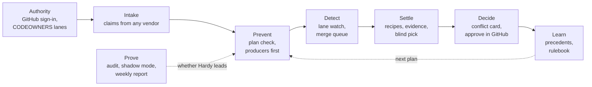

# Hardy: the referee (contingency module)

**What this is.** One design for Hardy, the referee that keeps owners' agents from colliding. Hardy is a **contingency**: the handover core works without it, and Hardy only becomes a lead feature if pilot teams of 5 to 10 people hit at least one real conflict a week (section 3). Code references point at commit `0137939` on `claude/eloquent-hopper-9m2e04`.

**Source.** Checked on 1 November against the research, now in the repo at `docs/research/Aurora_Full_Vision_and_Conflict_Referee_1.pdf` (22 October 2026, cited below as "research p.N"). The PDF contains **Hardy v1** (its "Task 1" framework, p.5-12) and **Hardy v2** (p.14-15). **It has no section labelled v3.** The nearest later material is Task 3, the standalone direction (open claims spec, any-vendor GitHub App, p.15-18), and "What to add to the pilot" (p.24-26). This file follows v2 and says where Aurora's own rules override the research. The spec (aurora-v1-spec.md:145-162) and pilot playbook are secondary sources.

**What changed when checked against the research** (first version of this file, 31 October, was built without it):

| Was (guesswork) | Now (research) |
| --- | --- |
| Six layers: prove, prevent, watch, settle, decide, learn | Eight layers (v2): **Authority** and **Intake** added; "Watch" is called **Detect** (p.14) |
| Settle recipes: "order, split, contract first" | Recipes are for **mechanical** conflicts only: lockfiles regenerated, changelogs and translations keep both (p.8, p.10). Producer-first ordering belongs to Prevent (p.7) |
| Contracts as `.aurora/contracts/*.yml` files | **Function and contract claims**: claims name functions, API routes and database tables, not only files (p.13-14). No contract file format is specified |
| Decide through a `DecisionRouter`, approval by email or app | Decisions happen **only in GitHub**, on a pull request Hardy prepared; other channels only alert (p.8, p.10 `decide_in: github`) |
| Standing rules may change routing and tier only | Research: after three matching rulings Hardy **offers to apply that kind automatically**, opt-in, revocable, switched off by the first human reversal (p.8, p.13). **Aurora overrides this**, see section 5 |
| "Owners can switch Hardy off per area" | Not in the research; dropped. Research: any owner can stop their own agent, the admin can stop all (p.11) |
| "The 20 repositories were never recorded" | **They are listed** on p.28; the method is on p.22. Section 3.1 |

## 1. Words used here

- **Claim**: what a task says it will change: files, and in v2 also functions, API routes and database tables (research p.14).
- **Owner area / lane**: the files an owner is responsible for, from the repository's CODEOWNERS file (p.5). Writing "outside its lane" means changing files the task did not claim.
- **Mechanical conflict**: lockfiles, changelogs, translations, generated files (p.8). **Textual conflict**: git cannot merge. **Semantic conflict**: both merge cleanly but break each other. **Product or authority conflict**: two intended behaviours, a question only people can answer (p.7-8).
- **Merge queue**: a GitHub feature that tests changes in the exact state they will be in after merging, in merge order (p.4, p.7).
- **Distinguishing tests**: tests Hardy writes so that two versions behave differently on them; running both versions shows which is right (S*, p.4, p.8).
- **Conflict card**: the message to owners: what conflicts, the evidence, Hardy's recommendation, buttons (p.9).
- **Precedent / rulebook**: a saved ruling; the rulebook is a file of rules the team edits in its own repo (p.13).
- **Shadow mode**: Hardy watches normal work for two weeks and reports what it would have done, changing nothing (p.12).
- **Different model family**: the judging model comes from a different maker than both agents, because judges favour their own outputs (p.3, p.11).

## 2. The eight layers (Hardy v2)

| Layer | What it does (research) | Extension point (ARCHITECTURE.md §5) | In the repo today | Size | Switched on |
| --- | --- | --- | --- | --- | --- |
| Authority | GitHub sign-in; owners from CODEOWNERS; admin where no owner; agent scopes signed by each owner (p.14, p.11) | Core identity edge, not an extension | CODEOWNERS read for owner areas (`plugin/src/repoareas.ts:27`); no GitHub sign-in, no signed scopes | L | With approvals-in-GitHub (ROADMAP 3.1) |
| Intake | Claims from Aurora's agents **and** any vendor's branches and PRs, via a GitHub App and an MCP claim tool (p.12, p.14) | **`ClaimSource`** (added to ARCHITECTURE.md for this) | Claims only from Aurora's own `propose_handover` (`plugin/src/tools.ts:36-69`) | M | When a pilot team mixes vendors |
| Prevent | Plan check: one owner per file, overlaps become a ticket, producers before consumers; v2 adds function/route/table claims and one owner a night for hot files (p.7, p.14) | `PreHandoverHook` | File claims, CODEOWNERS and open-claim check, moves to keeper (`plugin/src/prehandover.ts:44-83`) | S (move), M (functions, order) | Now (built) |
| Detect | Lane watch: stop an agent writing outside its claim, two agents changing the same lines back and forth twice, any run over budget; merge queue tests branches together; notices to agents whose code relies on a changed contract (p.7, p.14) | `RunWatcher`, `PreHandbackChecker` | Budget cap and pause (`plugin/src/handover.ts:139-141`); textual replay of ready branches (`plugin/src/replay.ts:58-73`) | M | Trigger |
| Settle | Classify; mechanical by recipe; textual/semantic by evidence then a blind pick (p.7-8) | `PreHandbackChecker` | None beyond replay | M (recipes), L (evidence, pick) | Trigger |
| Decide | Conflict card to the right people; approval **only in GitHub**; escalation (p.8-9) | `DecisionRouter` | Conflict notice email to the other owner (`plugin/src/briefing.ts:218-226`) | M | Trigger |
| Learn | Precedents; team rulebook in the repo; automatic rulings opt-in (p.8, p.13) | `DecisionListener` | Event log with reject reasons (`plugin/src/eventlog.ts:21-43`) | M | After about 20 rulings |
| Prove | 90-day collision audit, two weeks of shadow mode, signed log, weekly report, published owner-agreement rate (p.12-14) | None (offline tools and reports) | Collision audit (`tools/collision-audit/`, 20 tests pass) | S (shadow), M (report, log) | Now |

Sizes: **S** = up to 3 days, **M** = 1 to 2 weeks, **L** = 3 weeks or more, tests included. Research build order v2: H0 collision audit, H1 plan check any vendor, H2 shadow mode, H3 night watch and notices, H4 evidence and decisions, H5 rulebook and report (p.15).

## 3. The trigger

The research's own rule: "If teams of 5-10 see at least one conflict a week, Hardy leads the pitch; if not, it stays the safety net" (p.24, p.26), and "stop or pivot if pilot teams don't hit at least one conflict a week" (p.21). It counts **conflicts**, not overlaps. The spec's "overlap or conflict" (aurora-v1-spec.md:387) was looser than the research.

| Hardy layer | Switched on when, in a pilot team of 5 to 10, two weeks running |
| --- | --- |
| Prevent (file claims), Prove | Already on |
| Detect, Settle, Decide, Learn | **At least 1 real conflict a week**: textual conflicts found by the merge replay, shadow-mode conflicts, and breakages an owner reports where two clean merges broke each other. Overlaps alone do not count |
| Intake | A pilot team runs agents from two or more vendors (research condition 4, p.21) |
| Function claims, blind pick | As above, **and** the Hardy log shows breakages that file claims and textual replay missed |

Counted from the plugin's numbers (`plugin/src/numbers.ts:76`, `conflictsFoundAfter`) plus shadow-mode logs. Below the line after week 4: Hardy stays the safety net and the stop rule applies (aurora-v1-spec.md:390-394).

### 3.1 What the collision numbers mean (corrected 1 November)

**The 33% is unverified, not unrecordable.** PROGRESS.md:54 and `DEVIATIONS.md` (A9, on `claude/intent-audit`) say the 20 repositories "are not named anywhere". They are named on research p.28 (documenso, formbricks, plausible/analytics, unkey, hatchet, openstatus, dub, papermark, excalidraw, hoppscotch, umami, chatwoot, novu, trigger.dev, electric, tldraw, inngest, langfuse, twenty, infisical), and the method is on p.22. What is still missing is the scripts "shared alongside this doc": they never reached the repo, and the repo's scripts were rebuilt from the playbook later. **Nobody has re-run it.** Until someone does, do not quote 33%, nor the "1.5 to 4 conflicts a week" built on it.

**The two measurements are not the same thing**, so 1% does not refute 33%:

| | Research (p.22-23) | Repo's corrected audit (PROGRESS.md:58-72) |
| --- | --- | --- |
| Repositories | 20 named product companies, 12 months | 7 different public projects, 56 days |
| Who counts | Core team: 10+ commits; 13 teams had 2-10 core people | 3+ commits; 8 to 47 regular contributors |
| Pairs | 985 replayed, 439 clean, then only independent pairs from separate PRs: **34 of 103** conflicted (teams of 2-10) | 212 replays, 104 clean, follow-ups removed by `git blame`: **1 of 104** |
| Excluded | Lockfiles, changelogs, translations, generated files, docs | Only code files by extension; docs, data, lock files and generated folders left out (`tools/collision-audit/_audit.py:19-26`) |

Both are people, not agents. The research itself says its rates come from people, its three-days-a-night volume is an assumption, and 20 teams is a small sample (p.24). Read together: overlaps are common in both; textual conflict rates on human history range from about 1% to 33% depending on repositories and filters; **no measurement of agents in teams of 5 to 10 exists**. So the trigger counts real conflicts in the pilot, and nothing is built ahead of it.

**To settle the 33%** (ROADMAP item 1.18): run `tools/collision-audit/collision-audit-batch --fetch` on the 20 listed repositories over 22 Oct 2025 to 22 Oct 2026 with the research's filters (core 10+ commits). Expect more than 2 hours (`DEVIATIONS.md`). Differences in the rebuilt scripts may still move the number.

## 4. How a handover runs with Hardy (research v1, p.7-8)

1. **Plan check.** Every agent lists files and interfaces. No overlap: approved. Overlap: the file goes to its owner's agent, the other agent files a ticket (Aurora's hand-off). An interface change: producer first, consumers the next handover (NP-Bench).
2. **Watch.** Hardy stops an agent writing outside its claim, two agents changing the same lines back and forth twice, and any run over budget.
3. **Integrate.** Finished branches go through a merge queue; Hardy checks textual conflicts between branches.
4. **Classify** each conflict: mechanical, textual or semantic, product or authority.
5. **Gather evidence.** Each version's full test run, the combined run, and distinguishing tests Hardy writes in its sandbox. Agents cannot edit these tests.
6. **Recommend.** A model from a different family than both agents sees versions labelled A and B and structured evidence only. It recommends a version only when one clearly wins; otherwise "owner decision".
7. **Notify and decide.** Conflict card to the right people (table below); the owner approves in GitHub on a PR Hardy opened.
8. **Execute.** Through the merge queue under branch protection; the other branch closes with a ticket summarising it.
9. **Learn.** Each ruling saved as a precedent.

**Who decides** (research p.6):

| Situation | Decides | Told | If nobody answers |
| --- | --- | --- | --- |
| Both changes in one owner's area | That owner | The other agent's owner | Nothing merges; back in the next handback |
| Changes span two owners' areas | Both owners | Admin | Admin asked at the next plan check |
| Intended behaviour differs (product call) | The affected owners; admin if they disagree | | Hold |
| No owner listed | Admin | Both agents' owners | Hold |
| Security paths (auth, payments, secrets, migrations, CI) | Owner and admin | | Hold; never automatic |
| An agent wrote outside its lane | Owner of those files | Agent's owner and admin | That change is dropped from the branch |

**Levels and escalation** (p.9): Info (morning only), Decision, Blocker, Urgent (agents stop at once; secret in a diff, security path outside a lane, runaway budget, loop). Unanswered: reminder on the second channel after four working hours, admin at the next plan check, otherwise hold. Channels: GitHub for every decision; Slack and email to alert and open the card (email links land on a confirm page and still need sign-in); WhatsApp and iMessage for urgent alerts only (p.8-9). Use Paperclip's own experimental connectors before building new ones (p.9).

**Team policy file** `hardy.yaml` (p.10): owners file, `decide_in: github`, plan-check and briefing times, conflict policy by kind, security paths, escalation, each person's channels and quiet hours, admins. **Records** (p.10-11): Person, Agent, Claim, Conflict, Evidence, Ruling, Notification, Precedent.

## 5. Guardrails

From the research (p.5, p.11), unchanged:

1. **Hardy can** read every agent's plan, diff, test results and budget; pause or stop any agent's run; hold a merge and open a ticket; write and run its own tests in a sandbox; recommend with evidence; message owners and the admin.
2. **Hardy cannot** merge, push to shared branches or deploy; edit the tests or checks agents are judged by; read agents' keys or owners' tokens; choose between two intended behaviours; message anyone outside the team; overrule an owner.
3. **Two-model split**: the deciding model sees structured fields only; a quarantined reader with no tools turns agents' free text into the case card (CaMeL).
4. **No home advantage**: a different model family, versions labelled A and B.
5. **Evidence agents can't touch**: tests run in Hardy's sandbox.
6. **Signed authority**: owner identity from GitHub; each agent's scope and expiry signed by its owner.
7. **Fail closed**: if Hardy is down, nothing merges. Any owner can stop their own agent; the admin can stop all.
8. **Every action logged and attributed** to an agent and a person.

**Where Aurora's rules override the research:**

- **Automatic rulings.** The research lets an owner opt in to applying a repeated ruling automatically (p.8, p.13). Aurora's hard rule is that nothing merges without the owner's tap (CLAUDE.md hard rule 5; spec decision 15: "never without the owner"). So a precedent may **pre-fill the recommendation and move the item to "passed under your rules"**, where one tap approves the batch; it never merges on its own. Changing this needs your decision.
- **"Hardy stops an agent"**: in the plugin today the only stop is pausing the agent at the budget cap (`plugin/src/handoverrunner.ts:322-334`); Paperclip gives plugins no way to kill a running run (CLAUDE.md decisions, M3). Lane and loop stops are pauses until that exists.
- **At most three questions per owner per handover**, across all layers (aurora-v1-spec.md:151). Not in the research; kept from the spec.
