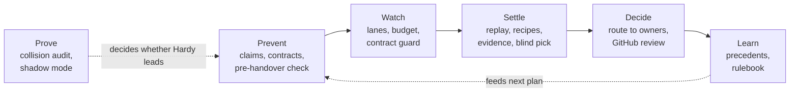

# Hardy: the referee (contingency module)

**What this is.** One design for Hardy, the referee that keeps owners' agents from colliding. Hardy is a **contingency**: the handover core works without it, and Hardy only becomes a lead feature if pilot teams of 5 to 10 people hit at least one real conflict a week (section 3; overlaps alone do not count). Code references point at commit `0137939` on `claude/eloquent-hopper-9m2e04`.

**Sources, and a gap.** The research text "Full Vision and Conflict Referee" (Hardy v1, v2, v3) is **not in this repository or its history**, and there is no `docs/research/` folder. This consolidation uses the spec's Hardy section (aurora-v1-spec.md:145-162), the build plan rows for M2 and M4 (aurora-v1-spec.md:303-311), the pilot playbook (pilot-playbook.md:114-180) and the six layers named in the brief. Where a v1/v2/v3 detail could change a layer, it says **NEEDS V1-V3 TEXT**. Paste the research and I will reconcile it.

**Status on 31 October.** The research was sent as an attachment, but the file never reached the design session, so this file has **not** yet been checked against it and every NEEDS V1-V3 TEXT marker still stands. `INTENT.md` (on `claude/intent-audit`) lists Hardy as out of scope for now, which matches treating it as a contingency.

## 1. Words used here

- **Claim**: the files and folders a task says it may change.
- **Owner area**: the files an owner is responsible for, read from the repository's CODEOWNERS file.
- **Contract**: a written agreement where two owners' areas meet (a request shape, a data format), with a version, an owner, the files it covers and a test that proves it.
- **Lane**: the set of files a task may touch (its claims). Staying "in lane" means changing nothing else.
- **Textual conflict**: git cannot merge two branches because they change the same lines. **Conflict in meaning** (semantic): both merge cleanly but break each other.
- **Evidence card**: one screen showing both sides of a conflict, the facts behind them, and what Hardy recommends.
- **Precedent**: a past ruling with its reason. **Standing rule**: a precedent the owner turned into a rule after it repeated three times.
- **Shadow mode**: Hardy watches a team's normal work and records what it would have done, changing nothing.
- **Different model family**: a judge model from another maker than the agents' model (for example, not Claude judging Claude), because judges favour their own family's work (aurora-v1-spec.md:161).

## 2. The layers at a glance

| Layer | Extension point (ARCHITECTURE.md section 5) | Already in the repo | Size if built | Switched on when |
| --- | --- | --- | --- | --- |
| Prove | None (offline tools) | Collision audit, complete | S (shadow mode) | Now: before and during the pilot |
| Prevent | `PreHandoverHook` | Claims and CODEOWNERS check | M (contracts L) | Now for claims; contracts on trigger |
| Watch | `RunWatcher` | Budget cap only | M | Trigger |
| Settle | `PreHandbackChecker` | Textual merge replay | M (semantic L) | Replay now; recipes and blind pick on trigger |
| Decide | `DecisionRouter` | Conflict notice to the other owner | M | Trigger; GitHub review is core work anyway |
| Learn | `DecisionListener` | Event log | M | Trigger, after about 20 rulings |

Sizes: **S** = up to 3 days of focused work, **M** = 1 to 2 weeks, **L** = 3 weeks or more, each with tests and a live check.

## 3. The trigger

Hardy leads only if pilot teams of 5 to 10 people hit **at least one real conflict a week** (section 3.1 explains why overlaps alone no longer count). Measured, not estimated:

- **Inside Aurora**: overlaps caught before plus conflicts found after, per team per week, from the numbers the plugin already computes (`plugin/src/numbers.ts:76`, `overlapsCaughtBefore`, `conflictsFoundAfter`).
- **Outside Aurora**: shadow-mode would-be conflicts between the team's open agent pull requests.
- **Rule**: two consecutive pilot weeks at or above 1 real conflict a week, in at least one team of 5 to 10 → build Phase 2 (ROADMAP.md) in the order the Hardy log shows (pilot-playbook.md:172-177). Below that after week 4 → Hardy stays at today's level (claims plus replay, already built and cheap to keep), and the spec's stop rule applies (aurora-v1-spec.md:390-394).

### 3.1 What the corrected collision numbers mean for the trigger

The spec's case for Hardy rested on a 33% conflict rate and "1.5 to 4 conflicts a week" for teams of 7 to 10 (aurora-v1-spec.md:31, :232). **The 33% cannot be reproduced**: the 20 repositories were never recorded, and the scripts did not exist on the date given (PROGRESS.md:54 on the working branch; `DEVIATIONS.md` finding A9 on `claude/intent-audit`). The "1.5 to 4 a week" was computed from that 33%, so it falls with it. Neither number may be used to argue for Hardy.

What was actually measured (PROGRESS.md:58-72): 7 public repositories, 56 days, same-day edits to the same file **0.4 to 36 times a week**, and **1 conflict in 104 clean replays**, about 1% (95% interval roughly 0.2% to 5.2%). Pairs that could not be replayed (108 of 212) are left out, and these are people, not agents.

What that means:

1. **Overlaps are common; textual conflicts are rare.** At 1%, even the busiest repository (36 overlaps a week) gives about 0.35 conflicts a week, and a typical 5-10 person team well under 0.1. Only at the top of the interval does the busiest one reach about 2 a week. **On human history, the conflict half of the trigger would not fire.**
2. **The trigger as first written ("one overlap *or* conflict a week") fires on overlaps alone**, so it would switch Hardy on without proving that settling is needed. It is split below.
3. **Agents may behave differently.** Outside studies report far higher rates for agent pull requests (aurora-v1-spec.md:23-25, :425), but they measure agents against their base branch or across tools, not our setting. They justify measuring in the pilot, not building ahead of it.

**Corrected trigger, layer by layer:**

| Hardy layer | Switched on when, in a pilot team of 5 to 10, two weeks running | Why |
| --- | --- | --- |
| Prevent (claims, pre-handover check) | Already on; stays on | Built, cheap, and overlaps are frequent |
| Watch, Settle, Decide, Learn (Phase 2) | **At least 1 real conflict a week**: textual conflicts found by the merge replay, plus shadow-mode conflicts, plus breakages an owner reports where two clean-merging changes broke each other. Overlaps alone do not count | This is the evidence the 33% claimed to give |
| Contracts, blind pick | As above, **and** the Hardy log shows breakages that claims and textual replay did not catch | These are the most expensive layers |

If no pilot team reaches 1 real conflict a week by the end of week 4, Hardy stays at today's level and the spec's stop rule applies (aurora-v1-spec.md:390-394). Overlaps caught before are still reported, as a measure of the pre-handover check.

## 4. Each layer

### 4.1 Prove: collision audit and shadow mode

- **Does**: before a team connects, replays 90 days of its git history and reports overlaps a week, the conflict rate and would-be conflicts a week. During the pilot, shadow mode replays the team's open agent pull requests once a day and logs what Hardy would have done.
- **Exists**: the collision audit, read-only, sends nothing, 20 tests passing today (`tools/collision-audit/_audit.py`, `tools/collision-audit/collision-audit`, `tools/collision-audit/replay_pairs_v2.py`). Shadow mode exists only as a manual checklist (pilot-playbook.md:145-157).
- **Build**: a `shadow` command that lists open pull requests through a read-only GitHub token, replays each pair from different owners with the same `git merge-tree` call as `plugin/src/replay.ts:14-33`, and writes a daily log. Size S.
- **Trigger**: now. It produces the evidence the trigger needs.

### 4.2 Prevent: claims, contracts, pre-handover check

- **Does**: before a handover, compares every task's claims with owner areas, open claims and contracts; fixes the order (work others depend on goes first); asks each owner at most three questions.
- **Exists**: claims are required (`plugin/src/proposal.ts:41-53`), matched with CODEOWNERS and open claims (`plugin/src/prehandover.ts:44-83`); overlapping tasks move to the keeper (`plugin/src/handoverrunner.ts:415-449`); questions are capped at three (`plugin/src/prehandover.ts:103-112`). Missing: contracts, ordering, GitHub teams in CODEOWNERS (warned only).
- **Build**: (a) move today's check behind `PreHandoverHook` as the built-in hook (S); (b) contracts: a `contracts` table {id, name, version, owner, consumers, covered paths, locked test command, status}, a contract file in the repo (`.aurora/contracts/*.yml`, **ASSUMPTION** on format), and a hook that blocks a task touching another owner's contract until that owner agrees (L); (c) ordering by declared dependencies between tasks (M). NEEDS V1-V3 TEXT for how contracts are proposed (the spec says Hardy proposes them, aurora-v1-spec.md:151).
- **Trigger**: claims now (built). Contracts only when the Hardy log shows overlaps that claims did not explain, for example two owners changing a shared request shape in different files.

### 4.3 Watch: lanes, budget, contract guard

- **Does**: while agents work, keeps each task inside its claimed files and budget, and pauses any change to a contract until its owner agrees.
- **Exists**: the per-handover budget cap with agent pause (`plugin/src/handover.ts:139-141`, `plugin/src/handoverrunner.ts:322-334`). Lanes are **not** enforced: an agent can write outside its claims and still be Ready (PROGRESS.md:260 on the working branch).
- **Build**: a `RunWatcher` that, every tick, reads changed file names in the task's worktree (`git diff --name-only` against the base, the same plumbing as `plugin/src/git.ts:35-53`) and flags files outside the claims; pause on a contract file. The core already gets a claims-vs-diff check at the checks gate (ROADMAP.md, Phase 1), so the watcher's extra value is only *earlier* warning. Size M.
- **Locked checks in Hardy's sandbox**: run the locked checks as a Hardy-owned system user, from the base branch's copy of the test files, never the agent's. Today checks run as the owner's own agent user (`plugin/src/checksandbox.ts:54-68`), so an agent can weaken its own tests. Size M. The spec's reason: at least 16% of long runs that looked successful were cheating (aurora-v1-spec.md:159).
- **Trigger**: lanes and locked checks on the trigger, or earlier if a pilot owner reports an agent editing tests.

### 4.4 Settle: replay, recipes, evidence, blind pick

- **Does**: at handback, test-merges every ready branch with the others; for each conflict, applies a known recipe where one fits, shows an evidence card, and, for conflicts in meaning, asks a judge from a different model family to pick blind.
- **Exists**: textual replay of ready branches, conflicts recorded once and announced to both owners (`plugin/src/replay.ts:58-73`, `plugin/src/conflictstore.ts:11-18`, `plugin/src/briefing.ts:205-226`). The email lists the files and the advice "agree which goes first" (`plugin/src/briefing.ts:274-289`). No recipes, no cards, no judge.
- **Recipes** (fixed, never free-form): *order*: approve A, then re-run B on top of the new base (a new handover task for B's owner, created only when B's owner taps it); *split*: the overlapping file moves to one owner's next task; *contract first*: the contract owner's change lands first. Each recipe only proposes; owners tap. Size M.
- **Evidence card**: both diffs for the conflicting files, both tasks' notes and check results, the recipe, and who must decide. Structured fields only. Size S to M.
- **Blind pick** (conflicts in meaning, version 2 in the spec, aurora-v1-spec.md:153): build distinguishing tests (tests that pass on one branch and fail on the other), run both branches in the sandbox, then give a judge from a different model family the two sides labelled A and B, with authors and owners removed, the test results and the contract text. The judge returns a recommendation and its reasons as a structured record; the owner decides. Size L. NEEDS V1-V3 TEXT for how distinguishing tests are generated and who approves them.
- **Trigger**: replay now (built). Recipes and cards on trigger. Blind pick only after textual settling has run for a month and the Hardy log shows conflicts in meaning.

### 4.5 Decide: owner routing and GitHub approval

- **Does**: sends each decision to the owner whose area it touches; a change in another owner's area needs that owner too; approval lands in GitHub as the owner's own review.
- **Exists**: the other owner gets a conflict notice (`plugin/src/briefing.ts:218-226`). Approval lands in GitHub, but with one person's token (CURRENT-STATE.md, S4).
- **Build**: a `DecisionRouter` that reads CODEOWNERS and contracts and returns the owners and the tier for each item (M). GitHub review as the owner (a GitHub App acting for each owner, aurora-v1-spec.md:182-190) is core work, not Hardy's, because every team needs it (ROADMAP.md, Phase 1 or 3 depending on your answer).
- **Trigger**: routing on the trigger; teams of 2 to 3 rarely need it.

### 4.6 Learn: precedents and rulebook

- **Does**: saves every ruling with its reason; after the same ruling three times, offers it to the owner as a standing rule; agents read the log before they plan.
- **Exists**: the event log with reject reasons (`plugin/src/eventlog.ts:21-43`, `plugin/migrations/001_task_events.sql`), and the numbers (`plugin/src/numbers.ts:76`).
- **Build**: a `DecisionListener` that stores precedents as {finding kind, area, recipe, decision, reason}; matching is exact on kind, area and decision (no model). A standing rule can only change **routing or tier** (for example, "green work in `docs/` goes to Passed under your rules"); it can never approve. Size M.
- **Trigger**: after about 20 rulings in one team, so there is something to learn from.

## 5. Guardrails (all layers)

1. **Hardy never approves, merges, or decides product questions.** The extension output types have no such member; the core refuses anything else (ARCHITECTURE.md section 5).
2. **Structured evidence only.** Hardy reads claims, file names, shas, check results, contract fields and numbers. Agent-written text (titles, descriptions, commit messages, test output) reaches Hardy only as `UntrustedText`, displayed escaped, never parsed for instructions (the CaMeL reason, aurora-v1-spec.md:160).
3. **Every Hardy action is logged** with actor `hardy`, its inputs and its output, in the append-only event log.
4. **Hardy has its own system user** for locked checks and no access to any owner's keys or the GitHub token.
5. **Fail closed for safety checks, advisory for opinions**: a crashed lane or contract check blocks the task; a crashed judge adds a note.
6. **Owners can switch Hardy off per area**; the core's built-in claims and replay checks stay on.
7. **At most three questions per owner per handover**, across all layers (aurora-v1-spec.md:151).
