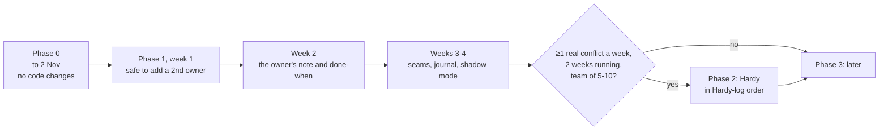

# Roadmap: from today's code to the target

**Words.** Technical terms are defined once, in the "Words used below" list of CURRENT-STATE.md.

**What this is.** The changes, in order, that take the code in CURRENT-STATE.md to ARCHITECTURE.md, with Hardy (HARDY.md) only if the pilot triggers it. Finding IDs (S1, B1...) are from CURRENT-STATE.md. Code references point at commit `0137939` on `claude/eloquent-hopper-9m2e04`.

**Sizes**: S = up to 3 days, M = 1 to 2 weeks, L = 3 weeks or more, tests and a live check included. **Risk** = the chance the change breaks something that works today.

## Phase 0: before 2 November (only what must change; nothing that risks the first real run)

The first real run (FIRST-REAL-RUN.md) has one owner, one test repository and one reviewer. Every code change now adds risk to the only thing that matters this week. So Phase 0 changes **no code**.

| # | What | Why | Size | Risk | Depends on |
| --- | --- | --- | --- | --- | --- |
| 0.1 | Put the newest code on `main`. **Decided 31 Oct (D8):** you merge [#4](https://github.com/singularity-inc-dev/aurora/pull/4) (the working branch plus doc fixes) into `main` before the run; the server installs from `main` | `main` lacks pieces A to G, and `claude/codebase-review-ad3lrs` switches the server to follow `main` (CURRENT-STATE.md, process risk). Running old code would make the run meaningless | S | Low: this is the code the 356 live checks ran on | Your review |
| 0.2 | Keep Paperclip membership to **you alone** until 1.1 ships; your reviewer works only on GitHub. **Decided 31 Oct (D7)** | S1: any signed-in member may be able to fetch every owner's Approve links. With one member there is nobody to exploit it | None | None | — |
| 0.3 | One read-only live check on the test bed: does a second, operator-role user get an answer from `GET /api/plugins/.../api/briefings/pending`? | Turns S1 from **ASSUMPTION** into fact; decides 1.1's urgency | S (an hour) | None | — |
| 0.4 | During the run, write down: does Paperclip record any cost for your subscription run (`public.cost_events`)? Does a retry ever overlap a running attempt? | Framework 9 (the budget cap may never trigger on subscriptions) and B5 | None | None | — |
| 0.5 | In the YC text, use only the measured numbers PROGRESS.md allows; do not cite the 33% | It could not be reproduced (PROGRESS.md:54 on the working branch) | None | None | — |

## Phase 1: the pilot (weeks 1 to 4)

### Week 1: safe to add a second owner

| # | What | Why | Size | Risk | Depends on | Refactor it forces |
| --- | --- | --- | --- | --- | --- | --- |
| 1.1 | **Route caller check.** Every plugin route accepts only the Aurora service's Paperclip user (`input.actor.userId`), set once by `vt-setup`; routes that act for an owner also need that owner's proof | S1. The per-owner model is fiction without it | S | Medium: a wrong user id stops all emails. Mitigate with a `vt-check` line and a live test | 0.3 | Pull auth out of the 17-case switch into one table of routes with their rules (`plugin/src/worker.ts:299-386`) |
| 1.2 | **No orphaned claims.** Store claims only after the run is saved; on any failure, release what was written | B1 | S | Low | — | — |
| 1.3 | **Checks run by the tick, not the agent.** When a ticket reaches done or in review, the tick runs the gate on the head | Framework 3; today "checks not run" is common if the agent forgets | S | Medium: changes when checks run. Keep `run_checks` as an extra | — | Move the gate call out of the tool handler (`plugin/src/worker.ts:231-286`) into the runner |
| 1.4 | **Claims against the diff.** A changed file outside the task's claims fails the gate | S6; the v1e test shows the hole | S | Low | 1.3 | — |
| 1.5 | **Decide the per-key read-only flag**: delete it, or wire `selectOwnerSecret` into a real path | S7: decorative security is worse than none | S | Low | — | Delete dead code in `plugin/src/secrets.ts` if dropped |

### Week 2: the owner's handover note

| # | What | Why | Size | Risk | Depends on | Refactor |
| --- | --- | --- | --- | --- | --- | --- |
| 1.6 | **Handover note, first version.** On the Hand over now page the owner writes, per task: what, done when (commands and manual items), claims, limits. Submit = approval; the plugin creates exactly those tickets and the run, runs the pre-handover check, and skips the agent's proposal and the plan confirmation. The agent's proposal stays as an optional "help me plan" setting, **off by default** (D5) | The product intent; also removes S2 for owner-written work (no "any human approves the plan" step) | M | Medium: a new entry path. Keep the agent-proposal path working beside it | 1.1 (the session proves the owner) | Split `plugin/src/handoverrunner.ts` into note intake, proposal (old path) and scheduler |
| 1.7 | **Done-when check.** Command items are locked at submit and run in the gate; manual items show on the handback item as a checklist marked "not machine-checked" | Framework 4 | M (with 1.6) | Low | 1.3, 1.6 | — |
| 1.8 | **Label agent-written text** in the plan and the email ("written by the agent", links not clickable) | Framework 6 | S | Low | — | One rendering helper instead of inline strings in `plugin/src/briefing.ts:252-330` |
| 1.9 | **Late work is not thrown away.** A task blocked by window end is re-checked when the handback is built; passing checks on a new head make it Ready | B4 | S | Low | 1.3 | — |
| 1.10 | **Stale claims end.** After 3 handbacks undecided, a task's claims are released and the item says so | B3 | S | Low | — | — |
| 1.11 | **Record what each task ran with** (base sha, note id, adapter and model, checks-config hash) and add cost per approved task to the numbers | Frameworks 7 and 9; cheap now, impossible to recover later | S | Low | — | New columns via migration 010 |

### Weeks 3 and 4: seams, journal, evidence

| # | What | Why | Size | Risk | Depends on | Refactor |
| --- | --- | --- | --- | --- | --- | --- |
| 1.12 | **Extension points, no behaviour change.** Define `PreHandoverHook`, `RunWatcher`, `PreHandbackChecker`, `DecisionRouter`; move today's claims check and merge replay behind them | Makes Phase 2 additive; proves the seam by hosting the core's own checks | M | Medium: touches the two most important checks. Same tests must pass unchanged | 1.4 | Yes: this is the main structural refactor |
| 1.13 | **Operations journal** for note submission, handback creation and approval publishing | B2 and every future multi-step write | M | Medium | 1.6 | Consolidate the store modules (one `Db` type, one JSON helper; today copied in `plugin/src/briefstore.ts:71`, `plugin/src/claimstore.ts:9`, `plugin/src/handoverstore.ts:12`) |
| 1.14 | **One shared package for wire types** used by plugin and email service | Today copied by hand (`plugin/src/links.ts:24-45` vs `email-service/src/paperclip.ts:21-41`) | S | Low | — | Yes |
| 1.15 | **Shadow mode command** (HARDY.md section 4.1) | Produces the evidence for the Phase 2 trigger | S | None (read-only) | Read-only GitHub token per pilot team | Reuse `plugin/src/replay.ts:14-33` logic |
| 1.16 | **Live checks** for S8 (does reassigning wake the new assignee?) and B5 (does a retry overlap the old run?) | Two **ASSUMPTIONS** with real consequences | S | None | — | — |
| 1.17 | **Spike: does an approval posted by a GitHub App for a person count under branch protection?** | The spec's stop rule depends on it (aurora-v1-spec.md:390-394) | S | None (test repository) | A test GitHub App | — |

## Phase 2: Hardy, only if triggered

Trigger: HARDY.md section 3. Build order follows the pilot's Hardy log (pilot-playbook.md:172-177); this is the default if the log is silent.

| # | What | Why | Size | Risk | Depends on |
| --- | --- | --- | --- | --- | --- |
| 2.1 | Lanes: `RunWatcher` warns while a task strays outside its claims | Earlier warning than 1.4 | M | Low | 1.12 |
| 2.2 | Locked checks in Hardy's own sandbox user, test files from the base branch | Agents cannot weaken their own tests | M | Medium (new system user in the server kit) | 1.3 |
| 2.3 | Evidence cards and fixed recipes (order, split, contract first) | Owners settle conflicts in one screen | M | Low | 1.12 |
| 2.4 | `DecisionRouter`: changes in another owner's area go to that owner too | Spec "Decide" | M | Low | 1.12 |
| 2.5 | Contracts and the contract guard | Only if the log shows cross-area breakage that claims miss | L | Medium | 2.1, 2.4 |
| 2.6 | Precedents and rulebook (rules change routing and tier only) | Fewer repeated decisions | M | Low | 2.4 |
| 2.7 | Conflicts in meaning: distinguishing tests and a blind pick by a different model family | Version 2 in the spec | L | Medium | 2.2, 2.3 |

## Phase 3: later

| # | What | Size | Notes |
| --- | --- | --- | --- |
| 3.1 | Approvals as each owner's own GitHub review (GitHub App) | L | Spec gap 13; after 1.17 says it can work |
| 3.2 | Inbox tiers (needs you, review suggested, passed under your rules) with one-tap batch | M | Spec gap 15, decision 15 |
| 3.3 | Scope and cost gauge with the 6-hour caution | M | Decision 8; thresholds from the pilot sheet |
| 3.4 | Tasks in parallel within one handover | M | B6 |
| 3.5 | Correlation ids, then OpenTelemetry from the Aurora service | S, M | Framework 8 |
| 3.6 | Eval and replay harness (baseline against candidate) | L | Framework 7; needs 1.11's records |
| 3.7 | Master agents with sub-agents inside the owner's subtree and budget | L | Spec gap 14 |
| 3.8 | Slack and phone notices; generated screens and MCP Apps | M, L | Decisions 9, 16 |
| 3.9 | One source of truth for settings (generate the validator from the schema) | M | `plugin/src/config.ts:170-553` |
| 3.10 | Rename the plugin key from `night-agents` | M | Paperclip ties settings to the key (`plugin/src/ids.ts:1-2`); needs a tested reinstall-and-migrate path. Low value; do last |
| 3.11 | Setup-free hosted instance per team | L | Decision 17 |

## Decision log

### Decided

| # | Decision | Date | What it changes |
| --- | --- | --- | --- |
| D5 | **The owner's handover note is the normal way to start a handover.** The agent's proposal stays as an optional "help me plan", **off by default**; when on, a proposed task never runs without that owner's approval | 31 Oct 2026 | Item 1.6 is built this way. `INTENT.md` (on `claude/intent-audit`) says the same |
| D7 | **During the first real run you are the only person signed in to Paperclip;** your reviewer works only on GitHub | 31 Oct 2026 | Phase 0.2. S1 cannot be exploited during the run. Item 1.1 must ship before a second person joins Paperclip |
| D8 | **The working branch is merged into `main` (#4) before the first real run, and the server installs from `main`** | 31 Oct 2026 | Phase 0.1. Code references in these documents (commit `0137939`) then match `main`'s plugin code |

### Open: only you can decide

| # | Choice | Options | My recommendation | Why |
| --- | --- | --- | --- | --- |
| D1 | How to build on Paperclip (decision 13) | (a) plugin plus own service; (b) plus small upstream changes; (c) fork | **(a) now, (b) as asks, never (c)** | Everything in ARCHITECTURE.md fits (a). Ask upstream for three small things (a "this user only" confirmation policy, public plugin routes, plugin database transactions) but depend on none. A fork means owning a codebase that shipped 28 releases in 7 months (aurora-v1-spec.md:297) |
| D2 | Licence (decision 14). **Answer requested 31 Oct; the reply had the blank template, so nothing is decided.** The LICENSE file stays MIT until you decide | MIT (in the repo now), Apache-2.0, AGPL-3.0 | **Apache-2.0 before the repository goes public** | As permissive as MIT and compatible with Paperclip's MIT, plus an explicit patent grant that companies' lawyers look for. AGPL would deter GitHub-scale copiers but also the teams you want. The moat is the hosted service and the decision data, not the licence |
| D3 | Hosting (decision 17) | One instance per team; shared multi-team cloud; self-host only | **One instance per team, plus self-hosting with the same kit** | Paperclip's plugin runtime is single-tenant (aurora-v1-spec.md:296); the kit is built and rehearsed; a shared cloud is a rewrite |
| D4 | Approval channel | (a) email link only (today); (b) email notifies, Approve needs a signed-in Aurora page; (c) Slack | **(a) for the first pilot team; (b) before a team with more than 3 owners or any paying team; (c) after** | (a) is fastest to approve, but anyone with the mail can approve (S3). (b) closes that at the cost of one sign-in; measure minutes-to-approve before and after |
| D6 | Low-risk tier (decision 15) | One tap per item; one tap per batch | **One tap per batch, never without the owner** | Agrees with the spec; build only after tiers exist (3.2) |
